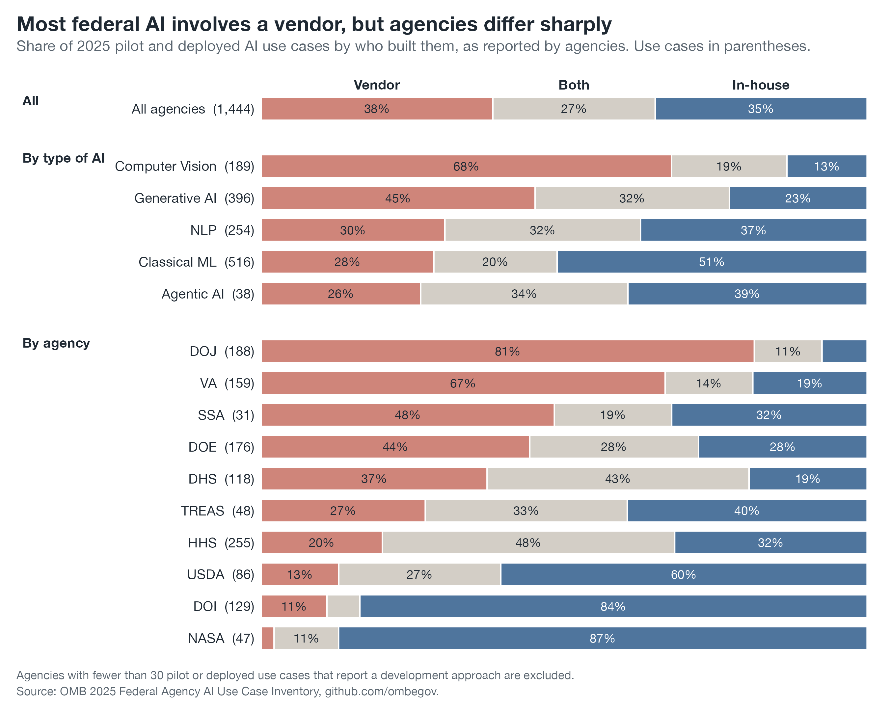
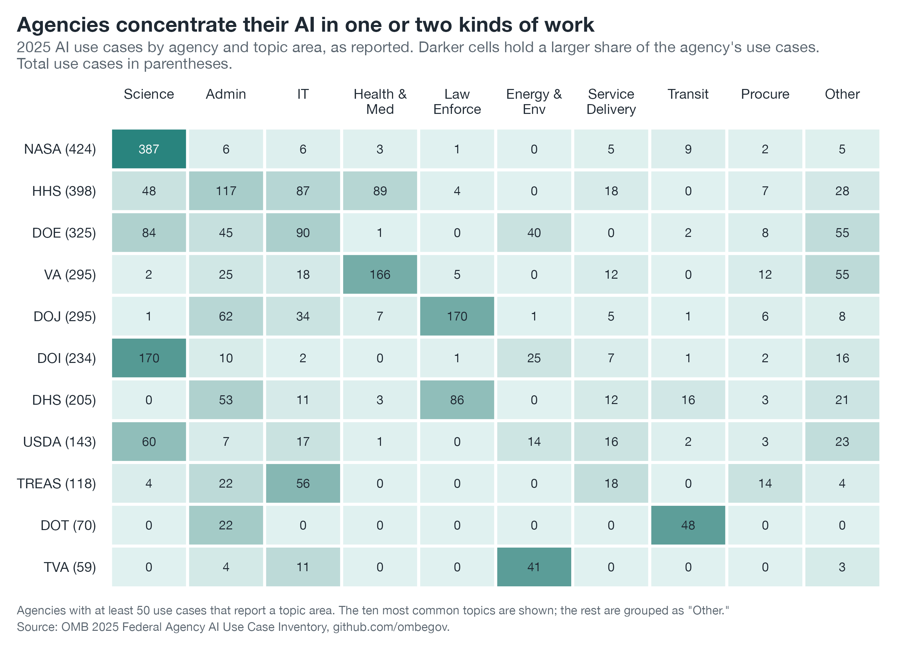
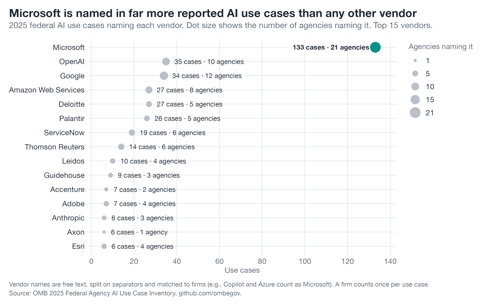
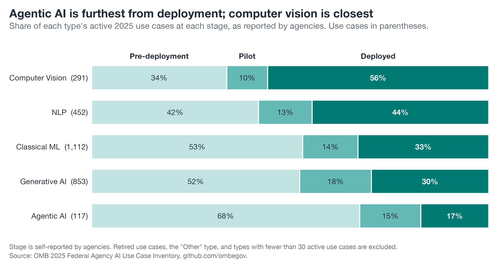
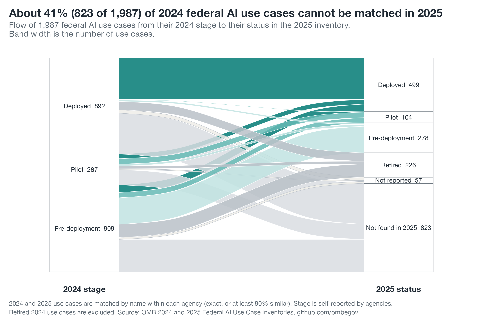

# Who Builds Federal AI?

Vendors, pilots, and deployment in federal AI, 2023–2025.

Data visualization project for PPOL 5202, Fall 2026.

Each year, federal agencies report the AI they use or are developing to the Office of Management and Budget (OMB). The count has grown quickly: 710 use cases in 2023, 2,133 in 2024, and 3,611 in 2025, though part of that rise reflects fuller reporting. But a count says nothing about who builds these systems or whether they ever leave the testing stage. In 2025, 38% of pilot and deployed use cases were bought from a vendor and 35% were built in-house; of the 287 pilots agencies reported in 2024, 43 show up as deployed a year later.

That raises the question this project asks: **who builds the AI that federal agencies run, and does it get past the pilot stage?**

The project uses the OMB AI Use Case Inventories for 2023, 2024, and 2025, and links a 2024 use case to the same use case in 2025 by name.

## The three proposal prototypes

The charts below are the proposal prototypes rebuilt in R with the project's design system ([`design_brief/proposal_restyle.qmd`](design_brief/proposal_restyle.qmd)). The original Tableau versions submitted with the proposal are in `proposal/figures/`.

**1. Most federal AI involves a vendor, but agencies differ sharply.** Of 1,444 pilot and deployed use cases in 2025, 38% were purchased from a vendor, 27% combined vendor and in-house work, and 35% were built in-house. The Department of Justice bought 81% of its AI; NASA built 87% of its own.



**2. Agencies concentrate their AI in one or two kinds of work.** NASA reported 387 of its 424 classified use cases in science, the Department of Justice 170 of 295 in law enforcement, and the Department of Veterans Affairs 166 of 295 in health and medical work.



**3. One vendor appears far more often than any other.** Microsoft is named in 133 use cases across 21 agencies, ahead of OpenAI (35 cases, 10 agencies) and Google (34 cases, 12 agencies).



The full proposal, including the data viability tables and the semester plan, is in [`proposal/`](proposal).

## The R visualization exercises

Each exercise has its own folder in [`r_viz/`](r_viz) with a Quarto document that builds one figure with ggplot2 and saves it to that folder's `figures/`. From Exercise 2 on, each document sources the project theme from the design brief.

**1. Older types of AI are much further along than newer ones.** Over half of 2025 computer vision use cases (56%) were deployed, compared with 30% of generative AI and 17% of agentic AI. Two-thirds of agentic AI use cases (68%) were still in pre-deployment. ([`viz1_ai_maturity.qmd`](r_viz/viz1/viz1_ai_maturity.qmd))



The figure above is the restyled version from the design brief; the version submitted for the exercise is `r_viz/viz1/figures/viz1_ai_maturity.png`.

**2. About four in ten 2024 AI use cases cannot be matched a year later, but deployed AI mostly stays deployed.** Of 1,987 use cases active in the 2024 inventory, 823 (41%) cannot be matched to a 2025 use case. Of the 513 deployed use cases that can be matched, 386 (75%) are still deployed; of the 145 matched pilots, 43 are deployed and 51 are still pilots. ([`viz2_pilot_flow.qmd`](r_viz/viz2/viz2_pilot_flow.qmd))



## The design brief

[`design_brief/`](design_brief) sets the visual system every later figure uses: a named color palette, one typeface with fallbacks, and six chart conventions (`design_brief.qmd`). `theme_project.R` turns those choices into palettes and a `theme_project()` function that each exercise sources. `viz1_restyle.qmd` rebuilds the first exercise with the system as a before-and-after pair, and `proposal_restyle.qmd` rebuilds the three proposal prototypes. Every figure in this README uses it: blue for AI built in-house, coral for AI bought from a vendor, and teal for the AI itself (its stage, counts, and the one highlighted item).

## What is in this repository

```         
proposal/     the proposal (Word and PDF), the packaged Tableau workbook,
              the original chart images, and the data behind each chart
code/         three R Markdown notebooks that download and build the data
data/         the analysis tables the notebooks produce
r_viz/        one folder per R visualization exercise (viz1/, viz2/), each with its
              Quarto document and figure
design_brief/ the design brief, the project theme script, and the restyled
              Exercise 1 and proposal charts

Data Access Links GitHub.docx   submission document linking to the two analysis tables
```

The figures use one analysis table, `ai_use_cases.csv`. The notebooks also build `workforce.csv` from OPM Federal Workforce Data, left from an earlier plan to set AI next to technical hiring; no current figure uses it.

| File | One row is |
|------------------------------------|------------------------------------|
| `data/processed/ai_use_cases.csv` | one AI use case in one inventory year (2023, 2024, 2025) |
| `data/processed/workforce.csv` | one count of federal employees: headcount at a snapshot, or hires or exits in a month |

The two tables are never merged: they measure different things, an AI use case versus a count of people. The only join is inside the OMB data, linking a 2024 use case to the same use case in 2025 by name. That match is saved as its own file, `data/keys/use_case_link_2024_2025.csv`, so it can be inspected and challenged.

## Reproducing the data

Knit the three notebooks in `code/` in order, from RStudio or the R console:

``` r
rmarkdown::render("code/01_download_data.Rmd")        # download the raw files (~380 MB)
rmarkdown::render("code/02_build_data.Rmd")           # build the two analysis tables
rmarkdown::render("code/03_build_tableau_data.Rmd")   # build the three chart tables
```

The first notebook skips files it has already downloaded, and the months are fixed at January 2024 through July 2026, so a later run reproduces the figures above. OPM revises recent months, so re-downloaded counts can shift slightly; the manifests saved with the raw files record the versions used. Paths are resolved with `here::here()`, so the notebooks run from any working directory. R packages: `tidyverse`, `arrow`, `jsonlite`, `here`, `rmarkdown`.

## Sources

| Source | URL |
|------------------------------------|------------------------------------|
| OPM Federal Workforce Data (EHRI status and dynamics files; built into `workforce.csv`, not used in current figures) | <https://data.opm.gov/get-data/data-downloads> |
| OMB 2025 Federal Agency AI Use Case Inventory | <https://github.com/ombegov/2025-Federal-Agency-AI-Use-Case-Inventory> |
| OMB 2023 and 2024 Federal AI Use Case Inventories | <https://github.com/ombegov/2024-Federal-AI-Use-Case-Inventory> |

## Judgment calls worth knowing about

- **No data file is edited by hand.** Every table in `data/` and `proposal/tableau_data/` is written by a notebook. Only the workbook layout and formatting were set by hand in Tableau.
- **Linking 2024 to 2025 use cases** relies on names, because the inventories share no stable ID. Names that match after normalization are linked outright; the rest are linked when they are at least 80% similar, a threshold chosen by reading sampled pairs. Section A4 of `02_build_data.Rmd` shows that check. The Department of the Interior added its 2024 inventory number to many 2025 names (e.g., "[2024 INV#WO0000000110496]"); that tag is removed before matching, which links 85 of Interior's 180 use cases from 2024 instead of 6.
- **The Department of Defense is not in the OMB inventories,** so every figure covers civilian agencies only. It is also left out of `workforce.csv`, because several of its components did not submit June and July 2026 data.
- **The 2023 inventory is read as UTF-8 and the 2024 inventory as Windows-1252**, the encodings the files actually use.
