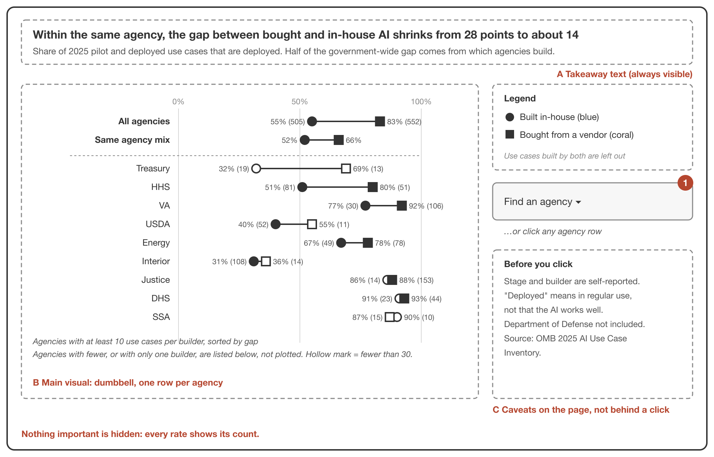
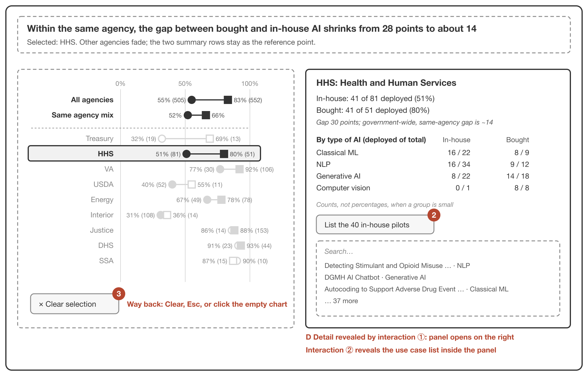

```{r}
# Every number in this brief is computed here from the analysis table
library(tidyverse)

use_cases <- read_csv("../data/processed/ai_use_cases.csv", show_col_types = FALSE)

# Step 1: 2025 pilot and deployed use cases built in-house or bought outright
built <- use_cases %>%
  filter(year == 2025, stage %in% c("Pilot", "Deployed"),
         build %in% c("In-house", "Vendor"))

# Step 2: deployed share for each agency and builder
by_agency <- built %>%
  group_by(agency, build) %>%
  summarise(n = n(), deployed = sum(stage == "Deployed"), .groups = "drop") %>%
  mutate(share = deployed / n)

# Step 3: government-wide shares
overall <- built %>%
  group_by(build) %>%
  summarise(n = n(), share = mean(stage == "Deployed"))
in_house_all <- overall %>% filter(build == "In-house")
vendor_all   <- overall %>% filter(build == "Vendor")

# Step 4: same-agency comparison. Keep agencies with at least 10 use cases per
# builder (the agencies the chart will plot; with fewer, one bought use case can
# swing the result), then weight each agency by its in-house count, because the
# question is about in-house AI: how far does it trail what its own agency buys?
wide <- by_agency %>%
  select(agency, build, n, share) %>%
  pivot_wider(names_from = build, values_from = c(n, share)) %>%
  filter(!is.na(`n_In-house`), !is.na(n_Vendor))
same          <- wide %>% filter(`n_In-house` >= 10, n_Vendor >= 10)
in_house_same <- with(same, sum(`share_In-house` * `n_In-house`) / sum(`n_In-house`))
vendor_same   <- with(same, sum(share_Vendor * `n_In-house`) / sum(`n_In-house`))
gap_same      <- vendor_same - in_house_same
gap_all       <- vendor_all$share - in_house_all$share
n_both       <- nrow(wide)
n_cases      <- sum(wide$`n_In-house`) + sum(wide$n_Vendor)
n_plotted    <- wide %>% filter(`n_In-house` >= 10, n_Vendor >= 10) %>% nrow()

pct  <- function(x) paste0(round(100 * x), "%")
pts  <- function(x) round(100 * x)
```

## 1. Audience and decision

**Policy problem.** Agencies now report thousands of AI use cases, but much of the AI they build themselves stalls before regular use, and oversight has no quick way to see where.

**Client.** The Partnership for Public Service, a nonpartisan nonprofit that trains federal leaders and briefs oversight committees.

**Primary user.** An oversight committee staffer covering agency technology, who knows agencies but not AI methods and has minutes before a meeting.

**Decision.** Whether to press the agency they cover about the AI it builds itself, and with which numbers.

**Central question.** *Does the AI the agency I cover builds itself reach regular use as often as the AI it buys?*

## 2. The case for interaction

**Static alternative.** One dumbbell chart comparing each agency's deployed share of in-house and bought AI, with a printed table of use case names.

**Limitation.** The dumbbell carries the main point, but a staffer preparing a hearing needs their agency's breakdown by type of AI and the systems still in pilot. Printing that for `r n_both` agencies (`r format(n_cases, big.mark = ",")` use cases) buries the one agency the reader came for.

**Minimum interaction.** Select an agency to open a panel with its counts and, on request, its in-house pilots.

**Risk.** False precision: only `r n_plotted` agencies have 10 or more use cases per builder, and a rate from 13 cases looks as solid as one from 153.

**Verdict.** Worth it, at this size only: the chart answers "is my agency unusual?" before any click, and one click turns that into a citable sentence.

## 3. AI personas and simulated interviews

Claude created two personas and role-played an interview with each, asking the same four questions: what would you learn first, compare, find confusing, and do with the answer?

- **Dana, committee staffer.** Goal: hearing questions for an agency's chief AI officer. Knows agencies, not data. Distrusts self-reports and dashboards that take ten clicks per number.
- **Ravi, Partnership analyst.** Goal: choose three agencies for an AI engineering program. Knows the OMB schema. Distrusts averages and percentages built on a handful of cases.

**Takeaways.** (1) Both asked first what "normal" looks like, so the summary rows sit on top. (2) Both distrusted bare percentages, so every rate shows its count and groups under 30 are hollow. (3) One click gives Dana a citable "41 of 81"; one more gives Ravi the names behind it, so depth comes from the panel, not filters.

**Disagreement.** Dana wants one number; Ravi wants each agency split by type of AI, and reads a gap as a question of what the agency chose to build, not a failing. The design serves both: Dana's number leads the panel, and Ravi's breakdown sits below it rather than in the overview.

**Assumption to check.** That users arrive with one agency in mind. These personas are design hypotheses, not evidence about real users.

## 4. Narrative arc

**Central claim.** Bought federal AI reaches regular use more often than AI agencies build, but half of that gap is a difference between agencies, not within them; capacity advice should target the few agencies where in-house AI lags what the same agency buys.

1. *Setup.* Reported federal AI grew from 710 to 3,611 use cases, most involving a vendor (proposal prototypes 1 and 3).
2. *Evidence.* Much never leaves testing: 43 of 287 pilots from 2024 appear deployed in 2025 (Exercises 1, 2).
3. *Evidence.* Bought AI is deployed more often, `r pct(vendor_all$share)` against `r pct(in_house_all$share)`, within every type of AI (planned figure: build gap by type of AI).
4. *Turn.* Two separate checks shrink the `r pts(gap_all)`-point gap: matching topic mix leaves about 18 (planned figure: gap by topic); comparing each in-house system with what its own agency buys leaves `r pts(gap_same)` (the interactive, Exercise 4).
5. *Implication.* Interior deploys about a third of its AI either way; HHS, and on small counts Treasury, is where in-house AI lags.

The state-bill map (Exercise 3) has no beat yet.

**Placement.** Beat 4, as a short Martini Glass: an author-driven stem (headline, annotated overview) opening into a reader-driven drill-down, just right of the spectrum's middle.

## 5. Shneiderman's mantra

**Overview first.** A dumbbell of deployed share, in-house (blue) against bought (coral). Summary rows on top: all agencies, `r pct(in_house_all$share)` against `r pct(vendor_all$share)`; same agencies, `r pct(in_house_same)` against `r pct(vendor_same)`, using the plotted agencies, weighted to where in-house AI is built. Below, `r n_plotted` agencies sorted by gap. The headline states the claim, so a reader who never clicks still gets it.

**Zoom and filter.** One control, *find an agency*, which highlights its row: Dana comes for one agency. No type-of-AI filter, because within any single type at most three agencies have 10 use cases per builder.

**Details on demand.** A right-hand panel: deployed counts per builder, a table by type of AI, and a searchable list of in-house pilots.

**The way back.** "Clear selection," Esc, or a click on empty space. Summary rows never fade, so the reference stays in view.

## 6. Core interaction plan

| User action | Product response | Value |
|---|---|---|
| ① Clicks an agency row or picks it from *Find an agency* | Others fade; panel opens: "In-house: 41 of 81 deployed. Bought: 41 of 51," plus a table by type of AI | A citable answer: is this agency's gap larger than the same-agency norm? |
| ② Clicks "List the 40 in-house pilots" | Searchable list of names and types of AI | Turns a rate into named systems to ask about |
| ③ Clicks "Clear selection" | Panel closes; all rows return | The next agency is read against the same reference |

## 7. Wireframes





## 8. Looking ahead: usability tasks

1. Report how many of HHS's in-house and bought use cases are deployed, out of how many. (Success: 41 of 81; 41 of 51.)
2. Among agencies with at least 30 use cases per builder, name the one with the largest gap. (Success: HHS, 30 points.)
3. Name one Interior in-house pilot, then return to the overview and state the same-agency gap. (Success: a listed name; "about `r pts(gap_same)` points.")

## Use of AI

I used Claude (Opus 5.5, through Claude Code). It created the two personas and role-played the interviews summarized above, computed the agency-level comparison in Section 4 from `ai_use_cases.csv`, drafted this text, and drew the wireframes.

**What I changed or rejected.** The same-agency gap depends on how agencies are weighted: 10 points if weighted by bought AI, 14 if weighted by in-house AI. Claude first reported 10, then proposed printing both. I rejected that: two numbers would confuse readers, and both personas ask about in-house AI. So the brief reports only the in-house weighting, 14 points, which also changed the claim from "most" of the gap to "half."

**How I checked it.** Every number in the brief is computed in the code chunk at the top of this document from the processed OMB table, not typed in. I re-counted HHS from the raw OMB table myself (41 of 81 in-house, 41 of 51 bought, 40 in-house pilots) and confirmed the same-agency row (52% against 66%) in RStudio. The persona answers are AI-generated and are reported as design hypotheses, never as user research.
